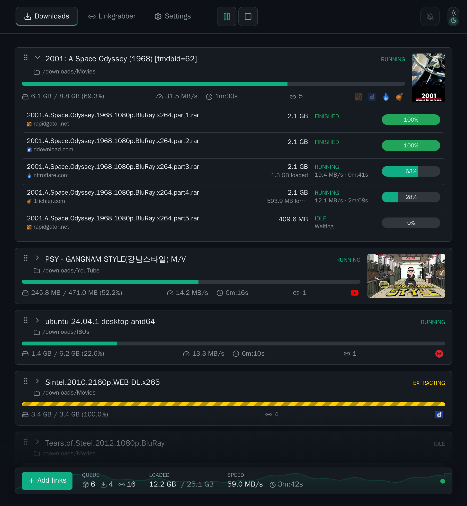
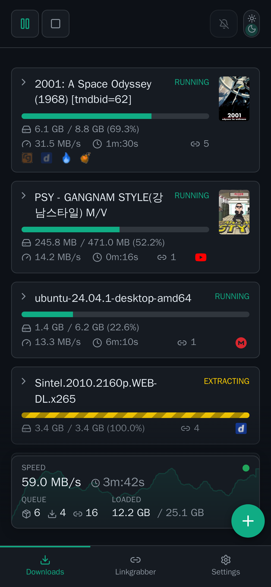
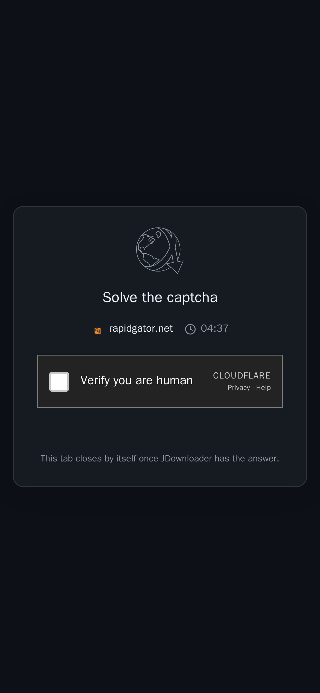

<p align="center">
  
</p>

<h1 align="center">My Own JDownloader</h1>

<p align="center">
  A faster, more modern, self-hosted take on <a href="https://my.jdownloader.org">MyJDownloader</a>.<br>
  Your own web UI for <a href="https://jdownloader.org">JDownloader</a>: one small container, your data stays with you.
</p>

The official MyJDownloader web page is a hosted service that every call has to travel through. My Own JDownloader runs on your side and
replaces it with something quicker and more current: a live UI that only moves when something changes, a direct line to your JDownloader
in the LAN, captchas and Click'n'Load that work on the phone too, and an MCP server for AI assistants. It controls JDownloaders that run
anywhere (a NAS, a server, your PC); nothing has to be installed next to them.

<p align="center">
  
  &nbsp;
  
  &nbsp;
  
</p>

## Contents

- [Features](#features)
- [Quick start](#quick-start)
  - [Configuration](#configuration)
  - [Direct connection](#direct-connection)
- [Browser extension and Android app](#browser-extension-and-android-app)
- [MCP](#mcp)
- [Development](#development)
- [Notes](#notes)

## Features

- **Downloads and linkgrabber** with live progress, speed graph and bandwidth history, drag and drop ordering, a context menu for everything
  JDownloader can do with a package or link (rename, priority, merge, split, move, extract, variants, reset, ...), and keyboard shortcuts.
- **Several JDownloaders** at once: pick one device or look at all of them together.
- **Captchas** solved in the browser: image captchas in the UI, token captchas (reCAPTCHA, hCaptcha, Turnstile) through the browser extension or
  the Android app, which render the widget on the hoster's own page. The backend also registers as an external captcha solver, so JDownloader asks
  for help instead of giving up.
- **All JDownloader settings** on one page. The page is generated from what the device reports, so a newer JDownloader needs no update here.
  Accounts, hosters, extensions, Basic authentication and system info included.
- **Browser extension** built on **Manifest V3**, so MyJDownloader is back in current Chrome and other Chromium browsers, where the old
  Manifest V2 extensions no longer run. Popup, Click'n'Load, captcha solving and self-update from this server (Firefox: built, not yet verified).
- **Android app**: notifications, captcha solving, Click'n'Load, share target, app lock, self-update.
- **Plugins** that add content to the UI. The bundled ones show movie posters from TMDB and YouTube thumbnails on the package cards.
- **MCP server** on `/mcp`, so Claude and other assistants can look at downloads and, if you allow it, change settings and add links.
  There is deliberately no tool to stop, pause or delete downloads.
- **Easy on the MyJDownloader API**: calls are shared, cached and rate limited, nothing is polled without a client, and with a direct
  connection the data calls go straight to your JDownloader in the LAN.
- Light and dark theme, works on phones.

## Quick start

You need Docker with Compose and a MyJDownloader account with at least one connected JDownloader.

```sh
git clone <this repository>
cd my-own-jdownloader
cp .env.example .env     # then fill in at least MYJD_EMAIL, MYJD_PASSWORD and UI_PASSWORD
docker compose up -d --build app
```

Open `http://<host>:3000` (the port is `APP_PORT` in `.env`) and log in with any username and `UI_PASSWORD`.

> **Set `UI_PASSWORD`.** The UI can change settings and read what your JDownloader holds. Without a password anyone who can reach the port can use it.
> Put the app behind HTTPS (a reverse proxy) if it is reachable from outside your network.

### Configuration

Everything is set in `.env` (see [.env.example](.env.example)):

| Variable | Purpose |
| --- | --- |
| `MYJD_EMAIL`, `MYJD_PASSWORD` | Your MyJDownloader account |
| `MYJD_DEVICE` | Device shown by default (optional) |
| `APP_PORT` | Port on the host (default `3000`) |
| `UI_PASSWORD` | Password for UI, API and MCP (HTTP Basic auth, any username) |
| `JD_SOLVER_URL` | Address under which the JDownloader reaches this app; enables the external captcha solver |
| `MCP_WRITE` | `true` allows the MCP tools that change something (the switch in the settings overrides it) |
| `MYJD_DIRECT` | `off` disables the direct connection |
| `PUBLIC_URL`, `AMO_JWT_ISSUER`, `AMO_JWT_SECRET` | Firefox extension signing, optional |

### Direct connection

By default every call goes through the MyJDownloader servers. If the app can reach your JDownloader in the LAN, it talks to it directly
(a few milliseconds instead of ~35 and no load on the API). The only requirement is network access to the device: with Docker, join the
network of your JDownloader container in a `compose.override.yaml` next to `compose.yaml`:

```yaml
services:
  app:
    networks:
      - default
      - jdownloader_default   # the network your JDownloader runs in

networks:
  jdownloader_default:
    external: true
```

If the address cannot be reached, the app falls back to the relay by itself. `GET /api/health` shows how many calls went each way.

## Browser extension and Android app

Both are offered by the app itself under **Settings > Browser extension / App** and update themselves from there.

- **Extension:** download the ZIP, load it unpacked in Chromium, and the options page can keep it up to date afterwards.
  Firefox needs a signed package; the backend can have one signed with your own AMO keys (`PUBLIC_URL` must be an https address).
- **Android app:** build the APK once with `android/build.sh` (everything runs in a container), then install it from the settings page.
## MCP

```sh
claude mcp add --transport http jd http://<host>:3000/mcp --header "Authorization: Basic <base64 of user:UI_PASSWORD>"
```

Read tools list devices, downloads, linkgrabber, accounts, captchas and settings. Tools that change settings or add links need
`MCP_WRITE=true` or the switch on the settings page.

## Development

Node and npm only run in containers:

```sh
docker compose run --rm dev npm install
docker compose run --rm dev npm run build
```

The backend is Fastify (TypeScript), the frontend Vue 3 with Vite. How plugins, the JDownloader settings page, the MyJDownloader client, the live
stream and the clients are built is in [DEVELOPER.md](DEVELOPER.md). A short guide to writing a plugin is there too.

## Notes

- This is an independent project and not affiliated with AppWork or JDownloader.
- The app holds your MyJDownloader credentials and plugins run with the server's rights. Only install plugins you trust.
